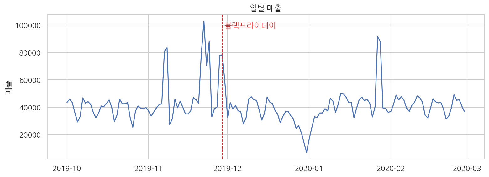
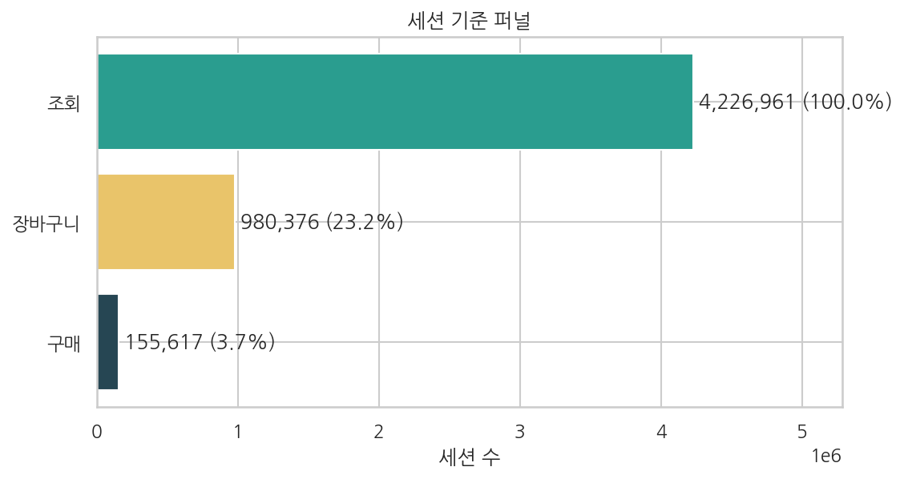
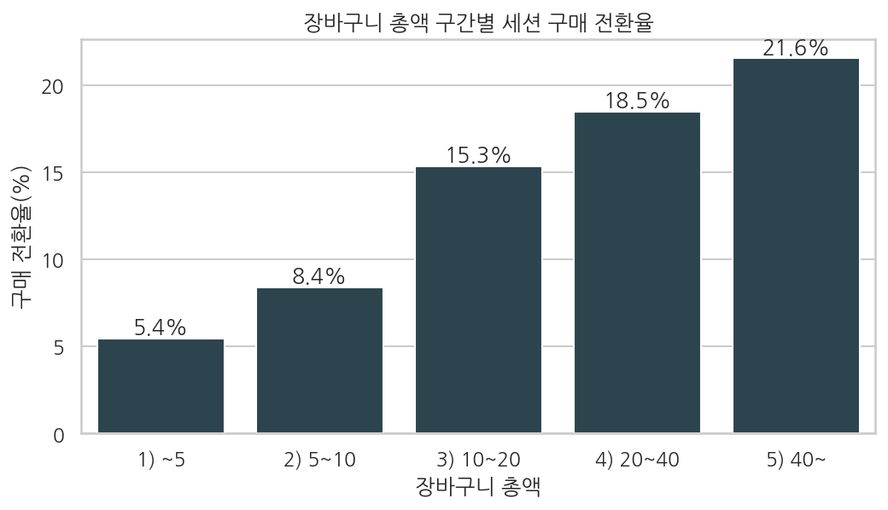
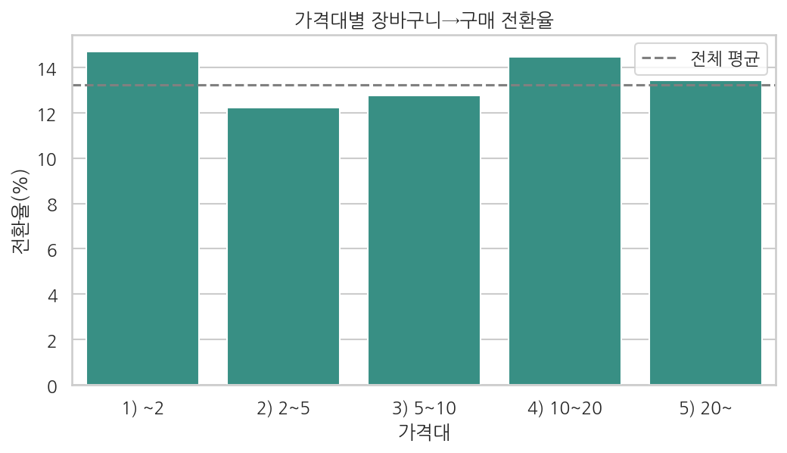
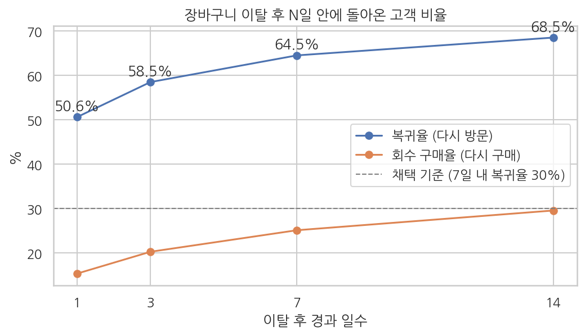

# 화장품 쇼핑몰 행동 로그 분석: 장바구니 이탈 원인과 전환율 개선 전략

화장품 쇼핑몰 행동 로그 2,069만 건을 SQL로 분석했습니다. 장바구니에 담고도 끝내 사지 않은 금액이 실제 매출의 2.80배에 이르는데, 원인은 상품 가격이 아니라 **작은 장바구니 총액**이었습니다. 이를 바탕으로 매출을 최대 약 11.8% 늘릴 수 있는 장바구니 회수 전략을 제안합니다.

| 항목 | 내용 |
|---|---|
| 기간 | 2026.10, 개인 프로젝트 |
| 도구 | DuckDB 기반 SQL, Python의 pandas, seaborn, scipy, Tableau Public, Google Colab |
| 데이터 | [Kaggle – eCommerce Events History in Cosmetics Shop](https://www.kaggle.com/datasets/mkechinov/ecommerce-events-history-in-cosmetics-shop), 2019.10 ~ 2020.02, 20,692,840행 |
| 분석 보고서 | [docs/analysis_report.pdf](docs/analysis_report.pdf) |
| 대시보드 | [Tableau Public – Cosmetics Shop Dashboard](https://public.tableau.com/views/CosmeticsShopDashboard/sheet6) |

---

## 1. 분석 목표

조회만 하고 구매하지 않은 채 떠나는 고객이 어디서, 왜 이탈하는지 찾아 구매 전환율을 높일 전략을 세우는 것이 목표입니다.

5개월 동안 약 164만 명이 방문해 약 450만 세션을 만들었지만, 구매가 일어난 세션은 3.47%뿐이었습니다. 새 고객을 데려오는 광고비보다 이미 온 고객을 구매까지 이끄는 편이 효율적이라고 보고, 이미 온 고객의 이탈에 집중했습니다.

가설 세 개는 앞 가설의 답이 다음 가설의 질문이 되도록 이어 놓았습니다.

| # | 질문 | 가설 | 판정 |
|---|---|---|---|
| 1 | 어디서 떠나는가? | 장바구니에 담은 상품의 절반 이상이 구매되지 않는다 | 채택 |
| 2 | 누가 떠나는가? | 저가 상품이나 소액 장바구니일수록 구매로 이어지지 않는다 | 부분 채택: 상품 가격은 기각, 장바구니 총액은 채택 |
| 3 | 다시 데려올 수 있는가? | 장바구니 이탈 고객의 상당수는 며칠 안에 돌아온다 | 채택 |

## 2. 데이터와 정제

| 점검 항목 | 결과 | 처리 | 이유 |
|---|---|---|---|
| 완전 중복 행 | 1,109,098건, 5.36% | 제거 | 시각, 사용자, 상품, 행동이 모두 같은 중복은 로깅 오류 |
| 음수 가격 | 131건 | 제거 | 판매가로 볼 수 없음 |
| 0원 가격 | 104,157건, 0.50% | 제거 | 사은품이나 샘플로 보이며 가격 분석을 왜곡 |
| 봇 의심 사용자 | 153명, 310,332건, 1.50% | 제거 | 5개월간 구매 0건이면서 이벤트 1,000건 이상. 장바구니 담기와 삭제만 반복한 계정이 이탈률을 부풀림 |
| 브랜드 결측 | 42.32% | `unknown`으로 대체 | 삭제하면 데이터의 40% 이상이 사라짐 |
| 카테고리명 결측 | 98.29% | 사용하지 않음 | 거의 비어 있음 |
| 일별 이벤트 | 152일 모두 존재 | 유지 | 연말 감소와 블랙프라이데이 급증은 실제 패턴 |

정제 후 20,692,840행이 **19,247,689행**으로 줄었습니다. 6.98%를 제거한 것이고, 사용자는 1,639,358명에서 1,637,825명이 됐습니다.

봇 기준은 500, 1,000, 2,000, 5,000건으로 바꿔 가며 제거 비율을 비교했습니다. 각각 3.04%, 1.50%, 0.77%, 0.36%였고, 최종 기준은 1,000건으로 정했습니다.

### 지표 정의
주문 ID와 수량이 없어서 다음처럼 근사했습니다.
- 주문은 구매가 발생한 세션 1개, 매출은 구매 이벤트 가격의 합으로 봅니다. 1행이 상품 1개입니다.
- 장바구니 → 구매 전환율은 장바구니에 담긴 세션과 상품 쌍 가운데 같은 세션에서 구매된 비율입니다.
- 가설은 **p < 0.05이면서 차이가 5%p 이상**일 때 채택합니다. 데이터가 커서 p-value만으로는 판단하지 않았습니다.

## 3. 분석 결과

### 전체 현황
| 매출 | 구매 고객 | 구매 세션 기준 주문 | 객단가 | 세션 구매 전환율 | 재구매율 |
|---|---|---|---|---|---|
| 6,348,268 | 110,518명 | 155,617 | 40.79 | 3.47% | 21.09% |



### 가설 1. 장바구니에 담은 상품의 절반 이상이 구매되지 않는다 → 채택



| 장바구니에 담긴 상품 4,736,219개 | 비율 |
|---|---|
| 같은 세션에서 구매 | 13.24% |
| 장바구니에서 삭제 | 20.81% |
| 담아 둔 채 방치 | 65.95% |
| 구매되지 않음 | **86.76%** |

- 같은 세션 기준으로 보면 미구매 금액은 약 2,199만으로 매출의 3.46배입니다. 하지만 여기에는 나중에 돌아와 산 경우와 여러 세션에 중복으로 담긴 금액이 섞여 있습니다.
- 그래서 고객 × 상품 단위로 다시 계산했습니다. 장바구니에 담긴 4,391,022쌍 가운데 74.3%는 5개월 동안 끝내 구매되지 않았고, 그 금액은 **약 1,780만으로 실제 매출의 2.80배**입니다. 결론에는 이 보수적인 숫자를 썼습니다.
- 삭제는 20.81%, 방치는 65.95%로 방치가 3배 많습니다. 상품이 싫어서라기보다 결제를 미룬 고객이 대부분이라는 뜻입니다.

### 가설 2. 저가 상품이나 소액 장바구니일수록 덜 산다 → 부분 채택




| 비교 | 전환율 | 차이 | 카이제곱 검정 |
|---|---|---|---|
| 상품 가격 5 미만 vs 5 이상 | 13.25% vs 13.23% | 0.02%p | p = 0.57, Cramér's V = 0.000 → 차이 없음 |
| 장바구니 총액 10 미만 vs 10 이상 | 6.66% vs 18.31% | 11.64%p | p < 0.001, Cramér's V = 0.173 → 유의하고 큰 차이 |

- 고객은 물건이 싸서가 아니라 **"한 번 결제하기엔 금액이 작아서"** 결제를 미룹니다. 장바구니 총액 구간별 전환율은 5.44% → 8.38% → 15.33% → 18.48% → 21.55%로 계단처럼 올라갑니다.
- 총액 10 미만 세션이 장바구니 세션의 47%를 차지합니다.

#### 상품 수 효과를 뺀 검증
총액이 큰 세션은 상품을 많이 담은 세션이기도 합니다. 그래서 상품을 1개만 담은 세션 424,486개끼리 다시 비교했습니다.

| 상품 1개 세션의 장바구니 총액 | ~5 | 5~10 | 10~20 | 20~ |
|---|---|---|---|---|
| 같은 세션 구매 전환율 | 4.56% | 5.30% | 11.35% | 13.55% |

상품 수를 고정해도 총액이 커질수록 전환율이 3배 가까이 오르니, 총액 효과는 그대로 유지됩니다. 저가 상품도 다른 상품과 함께 담기면 팔리지만, **저가 상품 하나만 담긴 장바구니**는 전환율이 4.56%로 거의 결제되지 않습니다.

- 한계: 비싼 상품을 고르는 고객은 원래 구매 의지가 강할 수도 있습니다. 인과관계는 A/B 테스트로 확인해야 합니다.

### 가설 3. 장바구니 이탈 고객의 상당수는 며칠 안에 돌아온다 → 채택



| 이탈 778,768건 이후 | 1일 | 3일 | 7일 | 14일 |
|---|---|---|---|---|
| 복귀율: 다시 방문 | 50.64% | 58.51% | 64.52% | 68.53% |
| 회수 구매율: 다시 구매 | 15.38% | 20.29% | 25.14% | 29.58% |

- 복귀의 74%가 24시간 안에 일어나고, 그 뒤로는 급격히 줄어듭니다.
- 7일 안에 돌아온 고객 중 약 61%는 **돌아와서도 사지 않았습니다.**
- 소액 장바구니 고객도 똑같이 돌아옵니다. 7일 내 구매는 24.56% 대 25.72%로 거의 같고, 소액 고객과 다른 고객의 차이는 첫 방문에서 결제하느냐에만 있습니다.

## 4. 종합 결론과 제안

장바구니에 담고도 끝내 사지 않은 금액은 매출의 2.80배이고, 원인은 작은 장바구니 총액입니다. 떠난 고객은 포기한 게 아니라 미룬 것에 가깝습니다. 그래서 **첫 방문에서 장바구니를 채워 결제하게 하고, 24시간 안에 돌아오지 않은 고객을 다시 부르는** 장바구니 회수 전략이 가장 효과적이라고 판단했습니다.

| 전략 | 근거 | 실행 방법 | 기대효과: 5개월, 보수적 가정 |
|---|---|---|---|
| 1. 소액 장바구니 채우기 | 가설 2 | 총액이 10 미만이면 "무료배송까지 ○○ 남았어요"라고 안내하고, 함께 많이 사는 상품을 추천 | 구매율을 6.66%에서 격차의 절반인 12.49%로 올리면 약 26,600건 × 주문 금액 중앙값 16.52 = 약 44만, +6.9% |
| 2. 24시간 리마인드 | 가설 1, 3 | 이탈 24시간 뒤에도 돌아오지 않은 고객, 즉 이탈의 49%에게 담아 둔 상품을 알림 | 384,400건 중 2%만 추가로 구매한다고 보면 약 7,700건 × 객단가 40.79 = 약 31만, +4.9% |
| 3. 돌아온 고객 결제 유도 | 가설 3 | 재방문 시 장바구니를 먼저 보여 주고 전략 1의 안내를 함께 표시 | A/B 테스트 후 목표 확정 |

단순 합은 약 75만으로 매출의 약 11.8%입니다. 다만 소액 장바구니 고객이 리마인드 대상에도 포함돼 일부가 겹치므로, **11.8%는 상한**으로 봐야 합니다. 저가 상품 할인은 가설 2의 결과로 보아 효과가 없을 가능성이 커서 제안하지 않았습니다. 모든 전략은 고객을 무작위로 나눈 A/B 테스트로 검증합니다.

## 5. 대시보드

[Tableau Public – Cosmetics Shop Dashboard](https://public.tableau.com/views/CosmeticsShopDashboard/sheet6)

대시보드는 분석 보고서와 달리 현황판으로 만들었습니다. 해석 없이 현재 상태만 보여 주고, 기준일과 기간 필터로 원하는 기간의 매출, 구매 전환율, 객단가, 퍼널, 브랜드 TOP10을 함께 바꿔 볼 수 있습니다. 기준일은 2020-02-29입니다. 전환율 같은 비율은 일별 값을 평균하지 않고 합계끼리 나눴기 때문에, 기간을 바꿔도 정확하게 계산됩니다.

## 6. 한계와 후속 과제
- 배송비와 쿠폰 정보가 없어서, 가설 2의 원인으로 본 배송비 부담은 추정에 그침 → 무료배송 안내 A/B 테스트로 검증
- 주문 ID와 수량이 없어 주문 수와 객단가는 세션 기준 근사치
- 관찰 데이터의 상관관계라 전략 효과는 확정할 수 없음 → A/B 테스트 필요
- 시간이 UTC 기준이고 현지 시간대가 공개되지 않아, 리마인드는 발송 "시각"이 아니라 "경과 시간"으로만 제안
- 복귀 후 구매한 상품이 장바구니에 담았던 상품과 같은지는 확인하지 않음
- 24시간 이내 복귀에는 세션이 잠깐 끊겼다 이어진 경우가 섞여 있을 수 있음
- 가격의 통화 단위가 공개되지 않아 금액은 단위 없이 표기
- 대시보드는 일 단위 집계라 하루를 넘긴 세션이 이틀로 잡힘. 그래서 전환율 3.44%, 객단가 40.40으로 보고서의 3.47%, 40.79와 조금 다름

## 7. 재현 방법
```bash
pip install -r requirements.txt
# data/README.md를 보고 CSV 5개를 data/raw/에 넣기 (Colab은 kagglehub로 바로 받기 가능)
python scripts/load_data.py          # DuckDB 적재
python scripts/run_sql.py all        # SQL 분석 → outputs/*.csv
jupyter nbconvert --to notebook --execute notebooks/analysis.ipynb   # 차트 → images/*.png
```

## 폴더 구조
```
├── data/        원본 CSV (GitHub 미포함, data/README.md에 받는 법)
├── sql/         분석 쿼리 (01 탐색 → 02 정제 → 03~08 분석 → 09 가설 검정 → 10~11 대시보드)
├── scripts/     적재·SQL 실행·노트북 생성 스크립트
├── notebooks/   시각화·카이제곱 검정
├── images/      README용 차트
├── dashboard/   대시보드 설계 문서
└── docs/        분석 보고서 (PDF)
```
